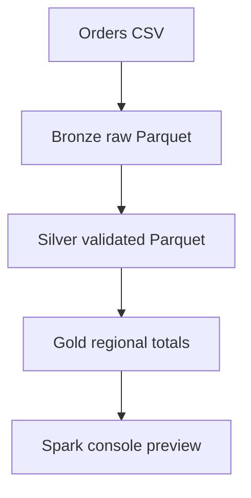

# PySpark Medallion Architecture

Turn an orders CSV into three local Parquet layers with PySpark. Bronze preserves raw text, Silver holds validated unique orders, and Gold exposes regional totals.

## Architecture



## Run the pipeline

1. Install Python 3.11 and Java 17. Check them with `python --version` and `java -version`. Set `JAVA_HOME` to your JDK installation if Spark cannot find Java.
2. Clone the repository and open a terminal at its root.
3. Install the project dependency in a virtual environment. These commands use a POSIX shell.

   ```sh
   python -m venv .venv
   . .venv/bin/activate
   python -m pip install -r requirements.txt
   ```

4. Run `python pipeline.py`. Expect east with one order and 20.00 in revenue, and west with two orders and 16.00 in revenue.
5. Inspect `output/bronze`, `output/silver` and `output/gold`. Spark writes each Parquet dataset as a directory. For example, read Bronze with `spark.read.parquet("output/bronze")` from a PySpark shell.

Silver trims identifiers, normalizes regions and casts amounts to decimal. It drops invalid records, collapses identical cleaned orders and excludes IDs with conflicting valid records. The sample includes one identical duplicate and one negative amount. Each run overwrites the three snapshots. Supply new paths with `--input` and `--output` to preserve the original run.
